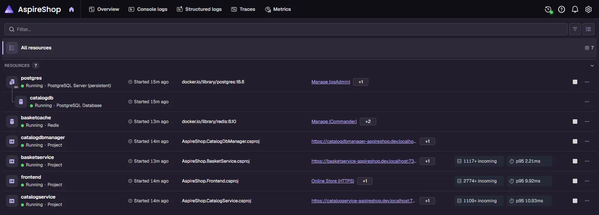
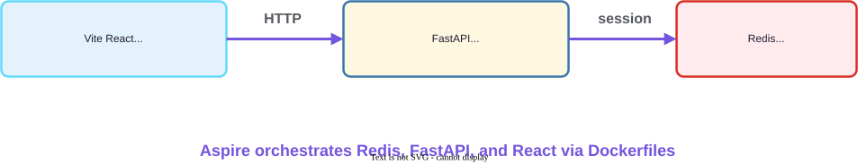
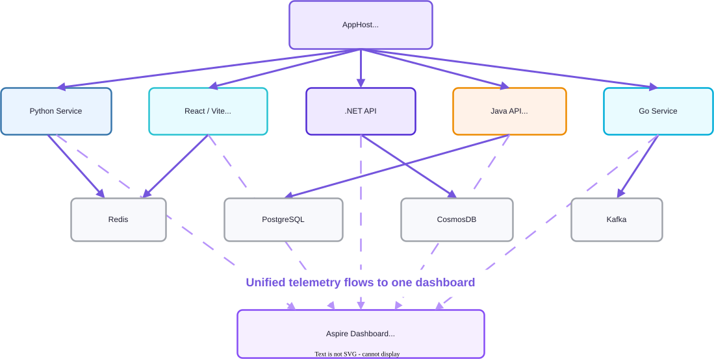
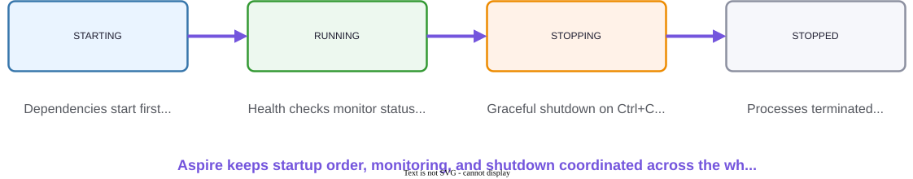
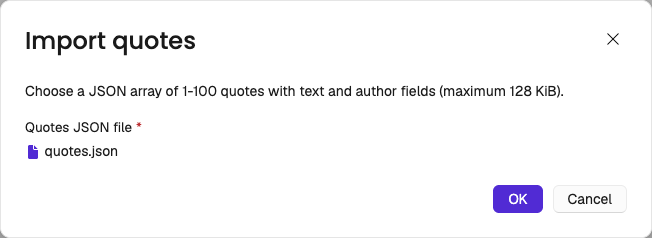
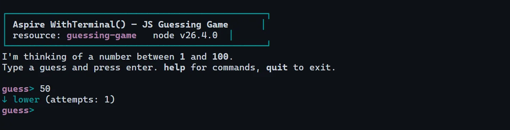
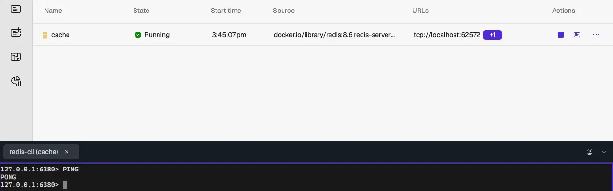
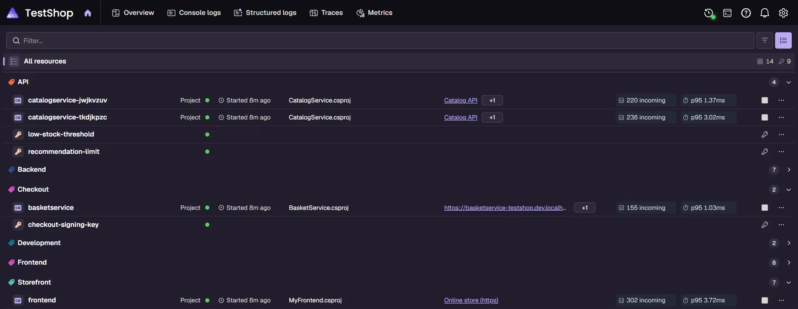

<!-- _footer: 'https://github.com/codebytes/aspire-polyglot' -->
<!-- _class: lead -->

# Polyglot Aspire

<p class="cover-tagline">One app model.<br><strong>Any AppHost.<br>Any workload.</strong></p>

## Chris Ayers

### Principal Software Engineer · Microsoft

---


## Chris Ayers

### Principal Software Engineer<br>Azure EngOps AzRel<br>Microsoft

<i class="fa-brands fa-bluesky"></i> BlueSky: [@chris-ayers.com](https://bsky.app/profile/chris-ayers.com)
<i class="fa-brands fa-linkedin"></i> LinkedIn: - [chris\-l\-ayers](https://linkedin.com/in/chris-l-ayers/)
<i class="fa fa-window-maximize"></i> Blog: [https://chris-ayers\.com/](https://chris-ayers.com/)
<i class="fa-brands fa-github"></i> GitHub: [Codebytes](https://github.com/codebytes)
<i class="fa-brands fa-mastodon"></i> Mastodon: [@Chrisayers@hachyderm.io](https://hachyderm.io/@Chrisayers)

---

<!-- header: 'The problem' -->

# The Polyglot Problem

> Modern apps are an **orchestra with no conductor**, and for polyglot teams,
> every section is reading from a different score.

Your team doesn't use one language. It uses **five**.

**Your stack today**
- Python ML services
- Go microservices
- Java Spring Boot APIs
- TypeScript/React frontends
- .NET backend APIs

**The question:** How do you orchestrate, observe, and wire all of this **from one place**?

<!-- We've all been there. The README says "just run docker-compose up" but it never works the first time. Five languages, one app, no map. -->

---

<!-- _class: compact -->
<!-- _transition: aspire-aperture -->

# The Orchestration Pain

**Five stacks. Five toolchains. Zero shared model.**

* 🚢 **Docker Compose**: explicit endpoint, dependency, and health-check configuration; telemetry is separate
* 📄 **Config sprawl**: `.env`, YAML, `application.properties`, `appsettings.json`, each with its own format
* 🔍 **No unified observability**: good luck tracing a request across four services in three runtimes
* 📜 **15-step READMEs**: "just `docker-compose up`" never works first time

<!--
Each pain point appears on its own click.
Compose supports health-aware startup with healthcheck and depends_on.condition: service_healthy. The contrast is the configuration you maintain and the separate telemetry tooling, not a missing Compose capability.
Source: https://docs.docker.com/compose/how-tos/startup-order/
-->

---

<!-- _class: gradient -->
<!-- _header: '' -->
<!-- _transition: reveal 450ms -->

# <!--fit--> Aspire: The Polyglot Answer

<p style="color:#ffffff; font-weight:500; max-width:1000px; margin:0.5em auto 0;">Aspire is an agent-ready, code-first tool to compose, debug, and deploy any distributed app.</p>

<!-- Use the official positioning sentence verbatim. Promise a concrete outcome: run a mixed-language app, follow one request, and understand the model that wires it together. The next slide turns that promise into the five questions this talk answers in order. -->

---

<!-- _class: compact -->
<!-- header: 'The answer' -->

# What Collapses Into One

**An illustrative five-service team—not a measured benchmark:**

<div class="chart">
<div class="hbars">
<div class="metric"><div class="name">Startup commands</div><div class="group"><div class="bar before" style="width:100%">5</div><div class="bar after" style="width:20%">1</div></div></div>
<div class="metric"><div class="name">Connection-wiring sources</div><div class="group"><div class="bar before" style="width:80%">4</div><div class="bar after" style="width:20%">1</div></div></div>
<div class="metric"><div class="name">Observability panes</div><div class="group"><div class="bar before" style="width:60%">3</div><div class="bar after" style="width:20%">1</div></div></div>
</div>
<div class="legend"><span class="key k-before">Without Aspire</span><span class="key k-after">With Aspire</span></div>
</div>

<!-- This is an illustrative before/after workflow, not repository benchmark data. One aspire run can coordinate five startup commands; the AppHost centralizes endpoint wiring previously spread across four places, and the dashboard brings telemetry into one view. Language toolchains and application configuration files still exist. Generated deployment artifacts can still include YAML and .env files. -->

---

<!-- _class: compact -->

# From One Laptop to a Platform

**Five questions every polyglot team asks, in this order:**

<div class="journey">
<div><span class="num">1</span><span class="step">Run it</span><span class="ask">Can I start everything with one command?</span></div>
<div><span class="num">2</span><span class="step">Model it</span><span class="ask">What produced that running app?</span></div>
<div><span class="num">3</span><span class="step">Share it</span><span class="ask">How does my team repeat it?</span></div>
<div><span class="num">4</span><span class="step">Grow it</span><span class="ask">Does it hold up with more services?</span></div>
<div><span class="num">5</span><span class="step">Ship it</span><span class="ask">Where does it run in production?</span></div>
</div>

**Aspire 17's theme:** from running apps to building platforms on top of them.

<!--
This is the map for the rest of the talk; the section header in the corner tracks where we are. Each step ends with something concrete: a live request, the code that modeled it, a team command, an event pipeline, and published artifacts.
Aspire 17 shipped on November 17, 2026 under the headline "ready for primetime". The team's framing: people were running dozens of services in one AppHost, sharing internal integrations, onboarding teammates, and deploying to infrastructure another team owns. They were not just running apps; they were building platforms on Aspire. Steps one and two are what Aspire has always done. Steps three to five are where 17 moved the most: team configuration sources, a dashboard redesigned for bigger apps, and stable Kubernetes deployment.
The version jumped from 13.6 straight to 17; there is no 14, 15, or 16.
Source: https://devblogs.microsoft.com/aspire/whats-new-aspire-17/
-->

---

<!-- _class: code-reference -->
<!-- header: 'Run it' -->

# Run It: One Command

**Install with a familiar package manager:** [get.aspire.dev](https://get.aspire.dev)

```bash
npm install -g @microsoft/aspire-cli
aspire new aspire-ts-starter -n my-app
cd my-app
aspire run
```

**Starters:** `aspire-ts-starter` · `aspire-starter` (C#) · `aspire-py-starter` · `aspire-go-starter` (new in 17)

**One coherent path:** install → scaffold → run.

<!--
First question: can I start everything with one command? Yes: aspire run starts every resource in the model and prints the dashboard URL.
npm is convenient for Node/TypeScript teams; Homebrew, WinGet, and the install script are also supported. Keep the workload's own toolchain installed.
Aspire 17 adds aspire-go-starter (Go API, React frontend, optional Redis, Go AppHost) and aspire-go-empty. aspire new without a template name lists every starter.
This is the audience's on-ramp, not a live project creation. The live proof is the FastAPI demo two slides ahead; the starter is the suggested first experiment after the talk.
Aspire 17 also adds shell completion (aspire completions script bash|fish|pwsh|zsh) and, in preview, a tray companion: aspire tray start keeps every running AppHost in the menu bar or notification area.
Sources: https://aspire.dev/get-started/install-cli/ and https://aspire.dev/reference/cli/commands/aspire-new/
-->

---

<!-- _class: compact release-slide dashboard-slide -->

# The Dashboard: Is It Running?

<figure class="release-screenshot">

<figcaption>Source: <a href="https://aspire.dev/whats-new/aspire-17/">aspire.dev: What's new in Aspire 17.0</a></figcaption>
</figure>

**Redesigned in 17:** it opens on your resources: state, endpoints, requests, p95.

**Then follow one request:** browser → API → backing service.

<!--
Core: the first thing people do after aspire run is wait for everything to turn green, then open an endpoint. The Aspire 17 dashboard opens on exactly that: a full-width resource table with state, source, endpoint links, incoming request counts, and p95 latency. Select a resource to bring its health, endpoints, logs, and telemetry into one view. Select the application name in the header to return to the table.
Console logs capture stdout/stderr; structured logs, traces, and metrics require OpenTelemetry SDK/exporter setup. Aspire supplies OTEL_EXPORTER_OTLP_ENDPOINT; it does not instrument every workload automatically. In 17, empty telemetry pages offer an Add telemetry dialog with the OTLP endpoints.
The new experience is still evolving. Settings > Dashboard experience switches back to the Previous dashboard when a distribution includes it.
Still there from 13.6: run history. The dashboard keeps resource snapshots and telemetry after the AppHost stops; the run selector switches between live and read-only past runs, up to 10 per application. Persisted telemetry can contain sensitive values and has no separate encryption or authorization layer. The dashboard remains a development and short-term diagnostics tool, not a production telemetry backend.
Repository samples still pin Aspire 13.6.1 and show the previous dashboard. Upgrade them with aspire update and rerun the smoke suite before presenting the 17 dashboard live.
Screenshot is the official release-notes example (AspireShop), not a capture of this repository's demos.
Transition: prove the polyglot promise with a TypeScript AppHost running React, FastAPI, and Redis.
Sources: https://aspire.dev/whats-new/aspire-17/ and https://aspire.dev/dashboard/explore/ and https://aspire.dev/dashboard/data-persistence/
Image: https://aspire.dev/_astro/dashboard-home.DpnZBDoN_ZT63Im.webp (footer row cropped).
-->

---

<!-- _class: compact -->
<!-- _transition: aspire-aperture -->

# Demo: Vite React + FastAPI

<div class="chips"><span class="host">TypeScript AppHost</span><span>React</span><span>FastAPI</span><span>Redis</span></div>



**Live:** Add a TODO → reload → follow its browser-to-API trace.

<!--
Question: can a TypeScript AppHost run a Python API and a React frontend without changing their languages or toolchains?
From samples/vite-react-api, start aspire run --apphost apphost.mts and open web from aspire describe. For a background worktree run, use aspire start --apphost apphost.mts --isolated.
Create a TODO with the Add button, create another with Enter, reload to show Redis-backed storage, then delete the test TODO. Inspect the trace that links a browser client span to the FastAPI server span.
Payoff: the AppHost language and workload languages are independent; one model wires the stack and one dashboard exposes the request.
Keep this stack running while explaining the model and basic CLI operations. Stop it before the Quotes Board demo.
Optional troubleshooting detail: the current/legacy container-hostname mapping in vite.config.ts gives the browser a reachable HTTP collector, not a container-only name or the gRPC port.
Transition: before explaining what produced that graph, show how to operate the running stack from the terminal.
-->

---

<!-- _class: code-reference -->

# Work with a Running Stack

**Inspect the model and its resources; do not guess ports or processes.**

```bash
aspire start     # Background
aspire ps        # AppHost summaries
aspire describe  # Resource details
aspire describe --format mermaid   # The running graph
aspire logs      # Console output
aspire stop      # Stop the app
```

`ps` summarizes **AppHosts**. `describe` shows **resources**, and in 17 exports their graph.

<!--
aspire ps summarizes AppHosts; use aspire describe for resource-level details. In 17 the Type column shows friendly labels such as Redis or PostgreSQL Server, and finished resources show their exit code.
New in 17: aspire describe --format mermaid prints the running resource graph as an unfenced Mermaid flowchart. Paste it into a pull request or design doc to show what is actually running. Parameters, endpoints, and resource state are not exported, and it cannot be combined with --follow. The dashboard graph has the same Export as Mermaid action.
Before the talk, run aspire doctor. In VS Code the dashboard no longer auto-opens by default: open it explicitly, or opt in with Aspire: Dashboard Browser / dashboardBrowser in launch.json.
Use ordinary aspire stop during the demo. aspire stop --force permanently deletes persistent resource data without an extra confirmation; it is not a harmless "stop harder" option.
In a worktree, prefer aspire start --isolated. When several AppHosts exist, specify --apphost rather than stopping or inspecting a different stack.
Use the running FastAPI stack for this inspect/log workflow. That answers the first question: one command runs it and one view shows it. Transition: the second question is what produced that running graph.
Sources: https://aspire.dev/reference/cli/commands/aspire-describe/ and https://aspire.dev/whats-new/aspire-17/
-->

---

<!-- _class: invert -->
<!-- _header: '' -->
<!-- _transition: reveal 450ms -->

# <!--fit--> How It Works

From AppHost code to running resources and connected services

<!-- Second question: what produced that running app? The mixed-language demo showed the result. Start with the four pieces, then explain cause before effect: author the model, add resources, wire relationships, then inspect the configuration received by each workload. -->

---

<!-- _class: compact -->
<!-- header: 'Model it' -->

# The Four Pillars

<div class="pillars">
<div class="entablature">Polyglot Aspire</div>
<div class="architrave"></div>
<div class="cols">

<div class="pillar p1">
<div class="cap"></div>
<div class="shaft">
<div class="icon">🛠</div>
<div class="pname">Aspire CLI</div>
<div class="ptag">Control plane</div>
<div class="pdesc">One command set to start, inspect, and deploy the stack.</div>
</div>
<div class="base"></div>
</div>

<div class="pillar p2">
<div class="cap"></div>
<div class="shaft">
<div class="icon">🗺</div>
<div class="pname">Aspire AppHost</div>
<div class="ptag">Stack in code</div>
<div class="pdesc">Services, dependencies, and endpoints declared together in code.</div>
</div>
<div class="base"></div>
</div>

<div class="pillar p3">
<div class="cap"></div>
<div class="shaft">
<div class="icon">📊</div>
<div class="pname">Aspire Dashboard</div>
<div class="ptag">App at a glance</div>
<div class="pdesc">Resource state, logs, traces, metrics, and interactive terminals.</div>
</div>
<div class="base"></div>
</div>

<div class="pillar p4">
<div class="cap"></div>
<div class="shaft">
<div class="icon">🧩</div>
<div class="pname">Aspire Integrations</div>
<div class="ptag">Building blocks</div>
<div class="pdesc"><strong>100+</strong> packages for data, messaging, AI, and clouds.</div>
</div>
<div class="base"></div>
</div>

</div>
</div>

<!-- Name the four pieces before opening any of them. Four pillars hold up the whole model: the CLI drives it, the AppHost declares it, the Dashboard shows it, and Integrations plug into it. Same four regardless of language. -->

---

<!-- _class: compact -->

# One Orchestrator. Every Language.

<div class="polyglot-flow">
<div class="flow-panel">

## Workload runtimes

🐍 Python · 🐹 Go · ☕ Java<br>
🟦 TypeScript · 💜 .NET · 🦀 Rust

</div>
<div class="flow-hub">

## Aspire AppHost

**C# · TypeScript**<br>
<small>Go (preview) · Python · Java · Rust (experimental)</small>

one run · one model

</div>
<div class="flow-panel">

## Same capabilities

🎯 Orchestration<br>
🔗 Service discovery<br>
📊 OpenTelemetry

</div>
</div>

<!-- Polyglot has two independent axes: the language used to author the AppHost and the languages used by its workloads. Six languages funnel into one orchestrator, and out come the same three capabilities: orchestration, service discovery, and observability. C# and TypeScript AppHosts are generally available. In Aspire 17, Go AppHosts moved from experimental to preview: no feature flag, and Go templates appear in aspire new and aspire init. Python, Java, and Rust AppHosts stay experimental behind the renamed experimentalPolyglotPython, experimentalPolyglotJava, and experimentalPolyglotRust feature keys. Separately, the Java and Rust workload hosting packages remain preview. -->

---

<!-- _class: apphost-morph -->
<!-- _transition: slide 600ms -->

# The AppHost: C#

**Write your AppHost in the language your team knows. Here's C#:**

```csharp
var builder = DistributedApplication
    .CreateBuilder(args);

var redis = builder.AddRedis("cache");

builder.AddPythonApp("api", "../api", "app.py")
       .WithReference(redis)
       .WithHttpEndpoint(env: "PORT");

builder.Build().Run();
```

**Declare resources and their relationships together.**

<!-- This is the canonical code example, not another architecture tour. Point out the cache, Python workload, and reference. C# is the original AppHost language. Advance directly to TypeScript: the title and code stay anchored while the authoring language changes. -->

---

<!-- _class: code-focus apphost-morph -->

# The AppHost: TypeScript

**Same app model. A different authoring language.**

```typescript
import { createBuilder } from "./.aspire/modules/aspire.mjs";

const builder = await createBuilder();

const cache = await builder.addRedis("cache");
const api = await builder.addPythonApp("api", "../api", "app.py")
  .withReference(cache);

await builder.addViteApp("web", "../web").withReference(api);
await builder.build().run();
```

**Generated SDK. Familiar resources, references, and endpoints.**

<!--
TypeScript AppHosts became GA in 13.4, when ASPIREATS001 was retired. Aspire 13.5 closes more parity gaps with C#. This does not make every AppHost authoring language GA: Go is in preview in 17, while Python, Java, and Rust remain experimental. Keep those labels separate from workload support.
Custom checks use builder.addHealthCheck(name, check) and resource.withHealthCheck(key). withContainerFiles and withContainerFilesCallback copy or generate container files. Keep these as examples of parity, not another API walkthrough.
Current entry points use apphost.mts. aspire update --migrate can migrate older apphost.ts projects.
Advance directly to Go: the title and code stay anchored while the authoring language changes a second time.
Sources: https://aspire.dev/whats-new/aspire-13-4/ and https://aspire.dev/whats-new/aspire-13-5/
-->

---

<!-- _class: code-focus apphost-morph -->

# The AppHost: Go

**New in 17 (preview): no feature flag, a starter template, F5 debugging.**

```go
func main() {
    builder, _ := aspire.CreateBuilder() // error checks trimmed

    cache := builder.AddRedis("cache")
    api := builder.AddUvicornApp("api", "./api", "main:app").
        WithReference(cache)
    builder.AddViteApp("web", "./web").WithReference(api)

    app, _ := builder.Build() // reports every resource error
    app.Run()
}
```

**Same resources and references.** Start it with `aspire run`, not `go run .`

<!--
Go AppHosts moved from experimental to preview in Aspire 17. The experimentalPolyglotGo flag is gone, aspire new offers aspire-go-starter and aspire-go-empty, and aspire init --language go adds a Go AppHost to an existing app. It is not generally available yet.
The slide trims error handling to fit. Real code checks the errors from CreateBuilder, Build, and Run, usually with log.Fatal(aspire.FormatError(err)). You do not check each resource: errors from the Add and With calls are collected and reported together by Build.
It needs Go 1.26 or later; aspire doctor checks that. The CLI generates a Go package into .aspire/modules/, mapped in go.mod as apphost/modules/aspire, and the starter's .gitignore keeps it out of source control. Start with aspire run because the CLI supplies the connection that the generated SDK uses.
Debugging: with the Go extension and Delve in VS Code, F5 steps through apphost.go, and the Aspire view can attach to running Go and .NET resources without restarting them.
This repository's samples/preview/svelte-go-bookmarks is a Go AppHost that still targets 13.6.1 and its experimental flag.
Transition: three languages, one generated import each. How does a non-C# AppHost call the hosting APIs? Answer it with the next paired ATS/DCP slides, then return to choosing and wiring resources.
Sources: https://aspire.dev/app-host/go-apphost/ and https://aspire.dev/whats-new/aspire-17/
-->

---

<!-- _class: paced -->
<!-- _transition: slide 600ms -->

# ATS: One Model, Multiple Languages

The **Aspire Type System** exposes hosting APIs to guest AppHost languages.

<div class="polyglot-flow">
<div class="flow-panel">

## Guest AppHost

**TypeScript · Go**<br>
<small>Python · Java · Rust (experimental)</small>

</div>
<div class="flow-hub">

## ATS

Typed SDK<br>local JSON-RPC

</div>
<div class="flow-panel" data-morph="app-model">

## .NET Hosting APIs

Resources<br>integrations

</div>
</div>

**Generated SDKs live in `.aspire/modules/`.**

<!--
The TypeScript and Go slides both imported a generated SDK. This slide answers one question: how can a non-C# AppHost use the hosting APIs? Keep this explanation brief; it supports the model rather than opening a separate internals chapter.
C# uses those APIs directly. Guest AppHosts use generated SDKs and a local JSON-RPC transport. Available API surfaces vary by integration and AppHost language; do not imply every package has complete cross-language parity.
New in 17, both in preview: hosting integrations can be authored in TypeScript, starting with @aspire/nuxt, and the CLI bundle includes an opt-in AppHost Server v2 (features.appHostServerV2).
Pause before the next question: who actually starts the resources?
Advance: the model panel slides left to become DCP's input, because DCP runs the model that the hosting APIs build.
-->

---

<!-- _class: paced -->

# DCP: Turn the Model into Processes

The **Developer Control Plane** runs the local resource graph.

<div class="polyglot-flow">
<div class="flow-panel" data-morph="app-model">

## AppHost Model

Resources<br>dependencies

</div>
<div class="flow-hub">

## DCP

Start · connect<br>monitor · stop

</div>
<div class="flow-panel">

## Running App

Containers<br>processes

</div>
</div>

**Development-time only.** Production uses the selected deployment target.

<!--
DCP is the Go-based, Kubernetes-compatible development orchestrator. The AppHost lowers its model to resource specifications; DCP reconciles those specifications, starts containers/processes, allocates ports, and reports lifecycle state.
This is separate from ATS and from the production target. Remember this boundary for the deployment section: reuse the app model, not the local development runtime.
Transition: put those pieces back into the architecture we just ran, then show how to add and wire resources.
-->

---

<!-- _class: compact -->

# Architecture Overview

**The model becomes running resources and a shared telemetry view.**



<!-- Connect the architecture to the opening FastAPI demo: the AppHost defines the graph, DCP runs its containers and processes, and instrumented workloads send telemetry to the dashboard. ATS lets guest AppHosts build that model. Now move from the whole picture to the resource choices a team makes. -->

---

<!-- _class: paced -->

# Start with a Workload Integration

**Keep the workload's toolchain. Let Aspire model how it runs.**

* 🐍 Python / ASGI → `AddPythonApp()` · `AddUvicornApp()`
* 🟦 JavaScript / TypeScript → `AddJavaScriptApp()` · `AddNodeApp()`
* ⚡ Vite frontend → `AddViteApp()`
* 💜 .NET project → `AddDotnetProject()` (by path, new in 17)
* 🐹 Go / Bun → `AddGoApp()` · `AddBunApp()`
* ☕ Java · 🦀 Rust → `AddSpringBootApp()` · `AddRustApp()` (preview)

**Prefer a typed integration when one fits.**

<!--
Each workload appears on its own click.
This is a choice map, not a list to memorize. Start with the workload the team already has and select its typed integration.
New in 17: AddDotnetProject from the stable Aspire.Hosting.Dotnet package adds a .NET project by path, with no ProjectReference from the AppHost and no generated Projects.* type. That is the polyglot payoff: C#, TypeScript, and Go AppHosts register a .NET service the same way, and the service can live in another solution. It accepts SDK-style C#, F#, and Visual Basic projects and file-based C# apps. Aspire coordinates the service builds, and the resource's Rebuild action picks up source changes without restarting the AppHost.
AddProject, AddCSharpApp, and the Aspire.AppHost.Sdk MSBuild SDK are obsolete but still work. aspire run --watch does not support the new resource model yet, so keep watch-dependent services on the legacy API for now. This repository's samples still use the 13.6.1 APIs.
Java and Rust hosting remain first-party preview packages: Aspire.Hosting.Java adds AddSpringBootApp, AddQuarkusApp, and AddJavaApp; Aspire.Hosting.Rust adds AddRustApp for Cargo apps.
Pause here: these are helpers for running familiar tools, not replacement language runtimes. Next, show how more integrations and the general-purpose resource types cover the rest of a real stack.
Source: https://aspire.dev/integrations/dotnet/migrate-dotnet-project-resource/
-->

---

<!-- _class: paced -->

# Bring the Rest of Your Stack

<div class="columns">
<div>

## More integrations

* Deno: `AddDenoApp()`
* Next.js: `AddNextJsApp()`

Both **stable in 17**.<br>TS/JS Azure Functions: **experimental**.

</div>
<div>

## Universal options

* `AddDockerfile()` — build an image
* `AddContainer()` — use an image
* `AddExecutable()` — run a process

**If it runs, it can join the model.**

</div>
</div>

Infrastructure joins the same graph: **Redis · PostgreSQL · Kafka · Cosmos DB**.

<!--
Five clicks: the two integrations, then the three universal options.
Aspire 17 retires the experimental diagnostics for the Deno hosting APIs (ASPIREDENO001) and for AddNextJsApp and the JavaScript publish helpers (ASPIREJAVASCRIPT001), so they no longer need suppressions. First-party AddDenoApp lives in Aspire.Hosting.JavaScript and differs from the Community Toolkit's Deno integration and its AddDenoTask. AddAzureFunctionsApp now hosts TypeScript and JavaScript Azure Functions; that API is experimental (ASPIREAZUREFUNCTIONS001).
Keep this separate from the first-party workload slide so the audience can see the escape hatches without losing the primary recommendation.
The backing-service APIs include AddRedis, AddPostgres(...).AddDatabase(...), AddKafka, and AddAzureCosmosDB. Our recipe demo uses RunAsEmulator, which selects the Linux-based vNext emulator in 13.6, for its local Cosmos DB instance. Hosting packages and preview status vary by integration.
The repository demonstrates both typed integrations and raw Dockerfile/container/executable resources. A raw container still needs explicit connection configuration and any health checks the application requires.
-->

---

<!-- _class: code-reference -->

# Wire Connections and Readiness

```csharp
.WithReference(redis)           // pass connection info
.WaitFor(redis)                 // wait for readiness
.WithHttpEndpoint(env: "PORT")   // expose HTTP
.WithExternalHttpEndpoints()    // public ingress
.WithHttpHealthCheck("/health") // readiness probe
```

**A reference supplies configuration. A wait supplies startup ordering.**

<!--
The resources are in the model; now describe their relationships. A reference passes configuration, a wait gates startup, and a health check defines readiness. The next slide shows those decisions over the resource's lifecycle.
Other useful helpers include WithUv and WithNpm for package managers. WithMcpServer describes a resource's own MCP endpoint; it is separate from the Aspire CLI's runtime MCP server discussed later. WithMcpServer and WithHttpProbe are stable in 17.
New in 17: AddParameter(...).AsOptional() marks a parameter that may be unset, while required parameters now reject empty values. Endpoints also expose PrimaryBrowserOrigin and BrowserOrigins, so CORS policies and sign-in redirects do not hard-code development URLs.
-->

---

<!-- _class: compact -->

# Resource Lifecycle Management

<div class="lifecycle-visual">

</div>

<div class="lifecycle-caption">Aspire keeps startup order, monitoring, and shutdown coordinated across the whole app.</div>

**Startup Gating:** `WaitFor(...)` holds dependents until a resource is ready
**Health Monitoring:** `WithHttpHealthCheck("/health")` reports readiness and status
**Graceful Shutdown:** Clean termination of all processes

<!--
WithReference wires configuration; it does not itself impose startup ordering. Use WaitFor to gate a dependent resource on its dependency's readiness. With a registered health check, WaitFor waits for healthy; without one, it waits for the Running state.
WithHttpHealthCheck reports readiness and dashboard status. It does not by itself promise automatic restarts on failure. Production liveness probes and restart policies belong to the deployment orchestrator.
Transition: we have declared the resources and their relationships. Next inspect the endpoint and connection settings that workloads receive.
Source: https://aspire.dev/fundamentals/health-checks/
-->

---

# Service Discovery: The Pattern

**Aspire injects service endpoints as environment variables:**

```bash
# Pattern: services__<name>__<protocol>__<index>
services__api__http__0=http://localhost:5000
services__frontend__http__0=http://localhost:3000
```

**Why double underscore?** `__` represents configuration hierarchy using shell-friendly names.

**No hardcoded service addresses.** Application configuration and toolchains stay in place.

<!-- Environment names are a portable interface across language runtimes. Double underscores represent the hierarchy in shell-friendly names; do not imply that framework configuration or deployment .env files disappear. -->

---

<!-- _transition: aspire-aperture -->

# Connection Strings: The Pattern

**Connection strings use `ConnectionStrings__<resource>`:**

```text
ConnectionStrings__messaging=localhost:9092
ConnectionStrings__recipesdb=<provider connection string>
```

**Typed Redis resources also expose `CACHE_URI`. Use the complete URI:**

```python
import os
import redis

client = redis.Redis.from_url(os.environ["CACHE_URI"])
```

**Case matters in Python/Linux. A connection string is not always a URI.**

<!--
Service discovery and connection strings share one universal interface: environment variables. Use the exact ConnectionStrings__ casing; Linux environment lookups are case-sensitive.
AddRedis("cache") plus WithReference exposes CACHE_URI and individual connection properties. CACHE_URI preserves the scheme, host, port, and credentials. Prefixing a StackExchange-style connection string with redis:// does not convert it to a valid URI. A preconfigured AddConnectionString resource exposes the connection string rather than the typed Redis properties.
Close the model-to-runtime loop: AppHost code produces configuration that a workload reads using its normal tools. That answers the second question. Next: how does a whole team repeat what one developer just did?
Source: https://aspire.dev/integrations/caching/redis/redis-connect/
-->

---

<!-- _class: invert -->
<!-- _header: '' -->
<!-- _transition: reveal 450ms -->

# From My Laptop to My Team

Automate team tasks. Open terminals. Connect agents. Pave the path.

<!-- Third question: how does my team repeat it? Build from one workflow to a shared platform: replace README steps with resource commands, extend them with terminals, give coding agents the same runtime context, then share the starting point itself. -->

---

<!-- _class: code-reference -->
<!-- header: 'Share it' -->

# Turn README Steps into Resource Commands

**Define a workflow once. Use it from the dashboard or CLI.**

**Quotes Board:** one custom `seed` command, two interfaces.

```bash
cd samples/dotnet-react-postgres
aspire resource api seed --help
aspire resource api seed --count 5
```

<div class="command-row">
<div><strong>Dashboard</strong><span>collects named inputs</span></div>
<div><strong>CLI</strong><span>accepts named options</span></div>
</div>

**Stable since 13.5:** command arguments and core prompts.

<!--
Connect this to the 15-step README problem: an integration author can make import, seed, or reset actions part of the resource model.
This is implemented in samples/dotnet-react-postgres/apphost.cs, not a built-in Aspire command. Start that AppHost first. The command appends 1-100 demo quotes through the API; the default count is 5. A count of 0 fails before any database write.
Declare CommandOptions.Arguments and read ExecuteCommandContext.Arguments; TypeScript has the corresponding ATS exports. The dashboard collects inputs while the CLI accepts named options and reports missing required values. If an argument collides with an Aspire option, separate command options with --.
Pause on the shared workflow before introducing richer input. Sources: https://aspire.dev/fundamentals/custom-resource-commands/ and https://aspire.dev/reference/cli/commands/aspire-resource/
-->

---

<!-- _class: release-slide -->

# Let a Command Ask for a File

<div class="columns">
<div>

## A guided import

- Choose `quotes.json`
- Validate content and size
- Import the whole batch

**Stable:** file inputs.<br>**Experimental:** progress dialogs.

</div>
<div>

<figure class="release-screenshot">

<figcaption>Live Quotes Board sample · Aspire dashboard</figcaption>
</figure>

</div>
</div>

<!--
This is the actual Quotes Board file picker, not an illustrative release screenshot. Import quotes uses PromptInputAsync with InputType.File, a .json filter, and a 128 KiB maximum. The AppHost validates uploaded bytes and calls the API's development-only batch endpoint. The entire batch is validated before a PostgreSQL transaction writes it.
File imports are dashboard-only in this sample; seed supports both the CLI and dashboard. Canceling before confirmation adds nothing, and demo/invalid-quotes.json demonstrates whole-batch rejection.
File inputs and core prompts are stable. Progress dialogs with optional cancellation remain experimental (ASPIREINTERACTION001); they are a dashboard interaction, not a prerequisite for a CLI command.
Source: https://aspire.dev/whats-new/aspire-13-5/
Image: captured from samples/dotnet-react-postgres using Aspire 13.5.3.
-->

---

<!-- _class: paced -->

# Demo: Quotes Board Commands

<div class="chips"><span class="host">C# AppHost</span><span>React</span><span>PostgreSQL</span></div>

**Seed from the terminal. Import from the dashboard.**

```bash
aspire resource api seed --count 5
```

<div class="command-row">
<div><strong>Seed quotes</strong><span>one named count argument</span></div>
<div><strong>Import quotes</strong><span>choose demo/quotes.json</span></div>
</div>

Click **Refresh quotes** → see new entries and the updated count.

**Same application. Two repeatable workflows.**

<!--
Question: can a team replace its manual seed/import instructions with one discoverable workflow?
Stop the opening FastAPI demo's AppHost first. From samples/dotnet-react-postgres run aspire start --apphost apphost.cs --isolated, then aspire wait api --apphost apphost.cs --status healthy. Open the dashboard and the web resource in separate tabs.
Run aspire resource api seed --count 5. Show the added count and IDs, then Refresh quotes in the board. Alternatively choose api > Actions > Seed quotes to show the same named argument in a dialog.
Next choose api > Actions > Import quotes, select demo/quotes.json, and click OK. The JSON result reports added: 3. Refresh the board and point to the three fixture authors.
If time permits, import demo/invalid-quotes.json and show the failed operation and unchanged count. Both commands append; this is not a reset or deduplicating import. No bespoke admin UI was needed.
The source stays file-based: TreatProjectReferencesAsResources=false shares API validation as a normal assembly reference, while AddProject registers the API by path. Keep this AppHost running through the workflow slides. Before switching to another live stack, stop it with aspire stop --apphost apphost.cs; preserve the data volume.
Payoff: the same modeled resource exposes repeatable team actions through both the CLI and dashboard. The next slides extend this running-resource workflow with interactive terminals, not another required application demo.
-->

---

<!-- _class: compact release-slide terminal-slide -->

# Not Everything Is an HTTP Service

**`WithTerminal()` is stable in 17:** REPLs, shells, and TUIs are resources too.

<figure class="release-screenshot">

<figcaption>Cropped from the <a href="https://devblogs.microsoft.com/aspire/whats-new-aspire-13-5/">Microsoft Aspire 13.5 announcement</a></figcaption>
</figure>

<div class="columns dashboard-columns">
<div>

Add `.WithTerminal()`. Find it on the **Terminals** page.

**Real input and output. One session, multiple viewers.**

</div>
<div>

```bash
cd samples/terminal-demo
aspire terminal ps
aspire terminal attach node-repl
```

</div>
</div>

<!--
Core: this is a capability callout, not a required AppHost switch. Keep the normal route focused on the Quotes Board workflow; resources can also expose an interactive session.
Optional demo: the screenshot shows Microsoft's JavaScript guessing-game playground. The commands use this repository's terminal-demo instead. Stop the Quotes Board AppHost before switching stacks, start terminal-demo with aspire run, evaluate 6 * 7 and process.stdin.isTTY in node-repl, and attach from another terminal to see the same session. Ctrl+B then D detaches without ending the process. Stop terminal-demo before starting the event-stream demo.
In Aspire 17, WithTerminal and TerminalOptions are stable and no longer report ASPIRETERMINAL001. AppHost-owned terminals, TerminalService, and the terminal automation APIs remain experimental. The 17 dashboard gives interactive terminals their own Terminals page instead of sharing Console logs; its selector lists only terminal-capable resources and their replicas. Terminal host resources are always hidden.
This repository's terminal-demo still targets 13.6.1, where C# callers suppress ASPIRETERMINAL001 and the terminal appears under Console logs. aspire terminal tape play (13.6) scripts repeatable terminal interactions.
Terminal-enabled resources run as plain processes and do not get automatic debugger attachment. Attach the debugger manually from your IDE when needed.
Sources: https://aspire.dev/app-host/with-terminal/ and https://aspire.dev/reference/cli/commands/aspire-terminal/ and https://aspire.dev/whats-new/aspire-17/
Image: https://devblogs.microsoft.com/aspire/wp-content/uploads/sites/90/2026/08/aspire-terminal-guessing-game.webp (cropped to the interactive content).
-->

---

<!-- _class: compact release-slide -->

# A Database Shell, Already Signed In

**Since 13.6:** `WithRepl()` adds a **REPL** command to data resources.

<figure class="release-screenshot">

<figcaption>Source: <a href="https://aspire.dev/dashboard/terminals/">aspire.dev: Use interactive terminals in the dashboard</a></figcaption>
</figure>

<div class="columns dashboard-columns">
<div>

The container's own client opens in the dashboard's **terminal dock**.

**PostgreSQL · MySQL · SQL Server · MongoDB · Redis · Valkey**

</div>
<div>

```csharp
builder.AddPostgres("postgres")
       .WithRepl();
```

</div>
</div>

<!--
Introduced in 13.6: WithRepl() / withRepl() adds a REPL command to PostgreSQL, MySQL, SQL Server, MongoDB, Redis, and Valkey resources. Selecting it runs the client bundled in the container (psql, sqlcmd, mongosh, redis-cli, and so on) in the dashboard's new terminal dock, with connection details and credentials already configured, so nothing installs locally.
It is opt-in because the session uses the resource's real credentials with full write access, and it works only in run mode. Only share dashboard access with trusted users.
Press backtick to show or hide the dock. Hiding the dock leaves sessions running: exit the client before closing its tab.
This complements the previous slide: WithTerminal() gives a console app its own terminal, while the dock and its experimental APIs let you open terminals into container and executable resources.
Live companion: samples/dotnet-react-postgres already enables .WithRepl() on postgres. Open postgres > Actions > REPL, then run \connect quotesdb and SELECT id, text, author FROM quotes ORDER BY id DESC LIMIT 5; to inspect the quotes just imported. Exit with \q before closing the tab. This continues the same Quotes Board demo without starting another stack.
The reference screenshot shows Redis on the 13.6 dashboard; the live sample demonstrates the same feature with PostgreSQL. Requires Aspire 13.6 or later; the repository samples use 13.6.1. In 17, the SQL Server REPL no longer discovers older sqlcmd paths: select SqlServerReplCommand.Version17 for images that only ship the older client.
Transition: the same discoverable resource state and actions can also give a coding agent useful runtime context.
Sources: https://devblogs.microsoft.com/aspire/whats-new-aspire-13-6/ and https://aspire.dev/dashboard/terminals/
Image: https://aspire.dev/_astro/redis-repl-dock.OdVXcskn_1CLwQQ.webp (cropped to the resource and the docked REPL).
-->

---

<!-- _class: compact -->

# Agent-Ready CLI

### A plugin for workflow. MCP for runtime context.

**Start with the Aspire plugin. Add MCP when the agent needs live application data.**

<div class="columns">
<div>

## 🧭 Aspire plugin

Skills teach agents the CLI, AppHost conventions, and debugging workflows.

**New in 17:** `aspire agent init` enables it in your agent's marketplace. No skill files copied into the repo.

</div>
<div>

## 🔌 Aspire MCP

The agent starts `aspire agent mcp` as a local **stdio** subprocess.

Read resource state, logs, and traces; execute resource commands.

</div>
</div>

**One runtime view** across Python, Go, Java, Rust, Node.js, and .NET.

<!--
Current guidance recommends the Aspire skills first and MCP when live runtime context is needed.
New in 17: aspire agent init asks which agents you use (GitHub Copilot, Claude Code, or OpenCode) and whether to configure them at project or global scope. It enables the aspire plugin from the microsoft/aspire-skills marketplace in each agent's own settings file instead of copying a skills folder into the repository, so guidance updates without waiting for a new CLI. The CLI no longer ships an embedded skills bundle, and it offers to remove stale copies written by older versions; that prompt defaults to No.
MCP is opt-in: choose it at the setup prompt or pass --mcp. The former dashboard-hosted MCP server was removed; there is no dashboard MCP button, HTTP endpoint, or API key. The dashboard AI Assistant chat UI was removed in 13.5.
MCP tools include list_resources, list_console_logs, list_structured_logs, list_traces, execute_resource_command, search_docs, and doctor.
In VS Code, extension 1.25 or later can attach a debugger to a running .NET or Go resource without restarting it, and agents can request the same through the aspire_resource_debug tool with your confirmation. The extension's tools return summarized state, not raw logs, environment variables, or dashboard login URLs.
Enabling the plugin does not run its workflows: review and approve migration or wiring changes before an agent applies them.
Sources: https://aspire.dev/get-started/aspire-skills/ and https://aspire.dev/reference/cli/commands/aspire-agent-init/ and https://aspire.dev/get-started/aspire-mcp-server/
-->

---

<!-- _class: compact code-reference -->
<!-- _transition: aspire-aperture -->

# Wire It Up in 30 Seconds

**Enable the plugin first; opt in to MCP when you need runtime access.**

<div class="columns">
<div>

**In your AppHost directory**

```bash
aspire agent init        # agents + scope
aspire agent init --mcp  # add MCP
aspire describe --format mermaid
```

Hand the agent a map: the running graph as Mermaid.

</div>
<div>

**Generated VS Code config**

```jsonc
{ "servers": {
    "aspire": {
      "type": "stdio",
      "command": "aspire",
      "args": ["agent", "mcp"]
    }
} }
```

</div>
</div>

<!-- Show this as setup guidance, not another required live initialization or AppHost launch; the Quotes Board is already running. aspire agent init edits the selected agent's settings file: .github/copilot/settings.json, .claude/settings.json, or opencode.jsonc at project scope. The MCP configuration shown is .vscode/mcp.json; Claude Code uses .mcp.json instead. It is only written when MCP is selected; the plugin does not require it. The agent launches aspire agent mcp over stdio, not an HTTP connection to the dashboard. aspire describe --format mermaid gives an agent a compact view of the topology that is actually running. Transition: the agent setup is one of three things a team can now share from a single source. Sources: https://aspire.dev/get-started/aspire-mcp-server/ and https://aspire.dev/reference/cli/commands/aspire-agent-init/ -->

---

<!-- _class: code-reference -->

# A Paved Path for the Whole Team

**New in 17:** share starters, integrations, and agent skills from Git, not a wiki.

```bash
# Try a starter straight from a Git repository
aspire new --template-repository https://github.com/Azure/aspire-templates

# Offer your team's defaults; the CLI asks before adopting them
ASPIRE_INIT_SOURCE_URL=https://github.com/example-org/aspire-init.git aspire init
```

<div class="chips sources"><span>templates → <code>aspire new</code></span><span>integrations → <code>aspire add</code></span><span>skills → <code>aspire agent init</code></span></div>

**Shared defaults, not enforced policy.** Developers still choose what to trust.

<!--
This is the headline theme of Aspire 17: teams are building platforms on top of Aspire, so a new teammate should find the service starter, the internal hosting integrations, and the agent skills that explain the infrastructure without piecing them together from a wiki.
One Git-backed configuration source holds an aspire.config.json. templateSources feed aspire new, integrationSources point aspire add at an internal NuGet feed with optional package patterns such as Team.Hosting.*, and skillSources configure the team's agent plugins. Named sources add to the built-in choices; they do not replace them.
ASPIRE_INIT_SOURCE_URL proposes a source and never silently applies it. The CLI displays it and asks for consent; pass --use-config-source to accept or --use-config-source false to decline in non-interactive runs. Refresh an adopted configuration with aspire update --config-source.
Security: templates and agent plugins can contain executable code, so only use sources you trust. Pin a branch, tag, or full commit SHA with --template-repository-ref or ASPIRE_INIT_SOURCE_REF. example-org is a placeholder; Azure/aspire-templates is a real repository to explore.
Polyglot angle: a platform team can publish a Go, TypeScript, or C# starter through the same commands every developer already uses.
That answers the third question. Transition: a shared starting point means more services. Does the model hold up as the app grows?
Sources: https://devblogs.microsoft.com/aspire/whats-new-aspire-17/ and https://aspire.dev/whats-new/aspire-17/
-->

---

<!-- _class: purple -->
<!-- _header: '' -->
<!-- _transition: reveal 450ms -->

# <!--fit--> When the App Grows

From HTTP requests to event-driven workflows: **16 verified samples**

<!--
Fourth question: does it hold up with more services? The opening React/FastAPI/Redis demo proved the basic polyglot workflow, and the Quotes Board made resource commands concrete. Now ask whether the same model can coordinate an event bus and consumers in multiple runtimes, and whether one dashboard stays readable. The event-stream demo is the only required live stack in this section; artifact publishing follows later.
The repository's 16 samples were validated end to end on Aspire 13.6.1, with the AppHost SDK, core packages, client integrations, and every Aspire.Hosting.* integration aligned on that release. They have not been revalidated on 17.0: upgrade with aspire update, review the breaking changes, and rerun scripts/Test-Samples.ps1 before claiming 17. Keep every Aspire package on one release: mixing package families across releases can cause MissingMethodException or TypeLoadException.
The repository demos exercise the same resource model across C#, TypeScript, Python, Go, and Java AppHosts.
Open the dashboard explicitly if VS Code does not auto-launch it. Use aspire describe to inspect resources and ordinary aspire stop to preserve persistent demo data.
Source: https://aspire.dev/whats-new/aspire-17/
-->

---

<!-- _class: compact -->
<!-- header: 'Grow it' -->

# Demo: Polyglot Event Stream

<div class="chips"><span class="host">C# AppHost</span><span>.NET</span><span>Python</span><span>Node.js</span><span>Kafka</span></div>

<div class="es-stage">
<svg class="es-diagram" viewBox="40 8 1120 386" role="img" aria-labelledby="es-title es-desc">
<title id="es-title">Polyglot event stream with Kafka</title>
<desc id="es-desc">The .NET producer publishes a sensor reading to the Kafka sensor-readings topic every 2 seconds, and Kafka delivers each reading to both the Python consumer and the Node.js dashboard. A custom reading of 42.5 °C and 95% humidity exceeds the alert thresholds, so the Python consumer publishes an alert to sensor-alerts, which the dashboard also consumes. The browser polls the dashboard over HTTP every 5 seconds.</desc>
<defs>
<marker id="es-arrow" viewBox="0 0 10 10" refX="10" refY="5" markerWidth="12" markerHeight="12" markerUnits="userSpaceOnUse" orient="auto"><path d="M0 0L10 5L0 10z" fill="#7455dd"/></marker>
<marker id="es-arrow-alert" viewBox="0 0 10 10" refX="10" refY="5" markerWidth="11" markerHeight="11" markerUnits="userSpaceOnUse" orient="auto"><path d="M0 0L10 5L0 10z" fill="#864df5"/></marker>
</defs>
<g class="es-tracks">
<path class="es-track" d="M280 111H486" marker-end="url(#es-arrow)"/>
<path class="es-track" d="M714 111H900" marker-end="url(#es-arrow)"/>
<path class="es-track" d="M600 154V300" marker-end="url(#es-arrow)"/>
<path class="es-track es-track-alert" d="M624 300V154" marker-end="url(#es-arrow-alert)"/>
<path class="es-track" d="M1025 302V152" marker-end="url(#es-arrow)"/>
</g>
<g class="es-packets" aria-hidden="true">
<circle class="es-pkt es-reading es-on-e1" cx="282" cy="111" r="7"/>
<circle class="es-pkt es-reading es-on-e2" cx="716" cy="111" r="7"/>
<circle class="es-pkt es-reading es-on-e3" cx="600" cy="156" r="7"/>
<circle class="es-pkt es-poll" cx="1025" cy="300" r="6"/>
<circle class="es-pkt es-anomaly es-on-e1" cx="282" cy="111" r="10"/>
<circle class="es-pkt es-anomaly es-on-e2" cx="716" cy="111" r="10"/>
<circle class="es-pkt es-anomaly es-on-e3" cx="600" cy="156" r="10"/>
<circle class="es-pkt es-alert es-on-e4" cx="624" cy="298" r="9"/>
<circle class="es-pkt es-alert es-on-e2" cx="716" cy="111" r="9"/>
</g>
<g class="es-node es-producer"><rect x="50" y="70" width="230" height="82" rx="14"/><text class="es-node-title" x="165" y="106">.NET Producer</text><text class="es-node-sub" x="165" y="131">HTTP API • dynamic port</text></g>
<g class="es-node es-kafka"><rect x="486" y="68" width="228" height="86" rx="14"/><text class="es-node-title" x="600" y="106">Apache Kafka</text><text class="es-node-sub" x="600" y="131">event bus • Port 9092</text></g>
<g class="es-node es-dashboard"><rect x="900" y="70" width="250" height="82" rx="14"/><text class="es-node-title" x="1025" y="106">Node.js Dashboard</text><text class="es-node-sub" x="1025" y="131">HTTP + JSON • dynamic port</text></g>
<g class="es-node es-consumer"><rect x="476" y="300" width="248" height="86" rx="14"/><text class="es-node-title" x="600" y="338">Python Consumer</text><text class="es-node-sub" x="600" y="363">rolling averages + alerts</text></g>
<g class="es-node es-browser"><rect x="924" y="302" width="202" height="74" rx="14"/><text class="es-node-title" x="1025" y="346">Browser</text></g>
<text class="es-label" x="383" y="97">sensor-readings</text>
<text class="es-label" x="807" y="97">both topics</text>
<text class="es-label es-start" x="644" y="219">sensor-readings ↓</text>
<text class="es-label es-label-alert es-start" x="644" y="243">sensor-alerts ↑</text>
<text class="es-label es-start" x="1039" y="222">HTTP polling</text>
<text class="es-label es-start" x="1039" y="243">every 5 s</text>
<g class="es-callout es-anomaly-note">
<path class="es-note-link" d="M165 152V178"/>
<rect x="50" y="178" width="230" height="62" rx="12"/>
<text class="es-mono" x="165" y="203">POST /api/events</text>
<text class="es-note-value" x="165" y="227">42.5 °C · 95% humidity</text>
</g>
<g class="es-callout es-detect">
<path class="es-note-link" d="M450 343H476"/>
<rect x="200" y="311" width="250" height="64" rx="12"/>
<g class="es-alert-icon"><circle cx="226" cy="334" r="10"/><text x="226" y="339">!</text></g>
<text class="es-detect-title es-start" x="244" y="339">Anomaly detected</text>
<text class="es-detect-rule" x="325" y="362">temp &gt; 35 °C · humidity &gt; 90%</text>
</g>
<g class="es-callout es-alert-chip">
<path class="es-note-link" d="M1025 56V70"/>
<rect x="900" y="18" width="250" height="38" rx="19"/>
<g class="es-alert-icon"><circle cx="924" cy="37" r="10"/><text x="924" y="42">!</text></g>
<text class="es-chip-text es-start" x="942" y="42">Alert reaches dashboard</text>
</g>
</svg>
<div class="es-legend"><span class="es-key es-key-reading">sensor reading · every 2 s</span><span class="es-key es-key-alert">alert · sensor-alerts</span><span class="es-key es-key-poll">browser poll · every 5 s</span></div>
</div>

<!--
The animated diagram previews the demo and replays on each visit: readings fan out from sensor-readings to both consumers every 2 seconds, then the custom 42.5 °C / 95% reading makes the Python consumer publish an alert that reaches the dashboard through sensor-alerts. It is a simulation, not live telemetry; the PDF shows the complete static diagram.
Question: can the same model coordinate asynchronous work across .NET, Python, and Node.js?
Stop the Quotes Board AppHost, or the optional terminal demo if used, before starting this stack.
From samples/polyglot-event-stream, start aspire run --apphost AppHost/AppHost.csproj. Show the five live sensors and Kafka topics, then publish a custom reading through the producer's POST /api/events with a unique sensorId, temperature 42.5, humidity 95, location "Demo laboratory", and the current UTC timestamp.
The Python consumer receives sensor-readings, calculates aggregates, and publishes the anomaly to sensor-alerts. The Node dashboard consumes both topics. Its browser fetches /api/readings and /api/alerts every five seconds; it does not use WebSockets.
Show the alert's two threshold reasons and the consumer's /api/aggregates endpoint. This proves the cross-language event pipeline; do not imply every Kafka hop is automatically part of one propagated trace. Stop this AppHost when done.
Payoff: one modeled graph coordinates more than HTTP request/response. Transition: five resources still fit on one screen. The next slide shows what Aspire 17 adds for apps with dozens.
-->

---

<!-- _class: compact release-slide dashboard-slide tags-slide -->

# Keep a Growing App Readable

<figure class="release-screenshot">

<figcaption>Source: <a href="https://devblogs.microsoft.com/aspire/whats-new-aspire-17/">Microsoft Aspire 17 announcement</a></figcaption>
</figure>

**New in 17 (experimental):** `.WithTags("Checkout")` groups services and their parameters.

Group by tag, type, or state. Select resources once; keep them across logs, traces, and metrics.

<!--
The dashboard redesign targets apps with dozens of services in one AppHost. Tags group resources by team or subsystem: give a checkout service and its signing-key parameter the same tag, then choose Group resources to group by tags, resource type, or state.
WithTags, WithTrait, and WithDisplayOrder are experimental in 17 (ASPIRERESOURCETRAITS001). You can also add personal tags in the dashboard without editing the AppHost: shared tags give everyone a starting point, and personal tags organize the app around the work in progress.
The shared resource pane keeps a selection as you move between pages. Ctrl-click (Command-click on macOS) to add a resource in Structured logs, then switch to Traces or Metrics and the selection comes with you. All resources shows a health summary: resource states, live request activity, error rate, p95 latency, the slowest endpoints, and the busiest resources. Metrics appear as cards with sparklines that you can pin.
Switch to Graph to see how services and dependencies connect, and export that graph as Mermaid for a pull request or design doc.
Optional crowd-pleaser: select Play Aspire Outage at the bottom left of the resource graph (or press O three times) for an arcade game where your resources are the enemies. Do not choose hardcore mode during a demo: destroying an enemy really stops its resource.
The screenshot is Microsoft's TestShop playground, not this repository's demos, which are untagged.
That answers the fourth question. Transition to production without another internals detour: DCP runs this graph locally; a production target needs its own explicit configuration.
Sources: https://devblogs.microsoft.com/aspire/whats-new-aspire-17/ and https://aspire.dev/dashboard/explore/
Image: https://devblogs.microsoft.com/aspire/wp-content/uploads/sites/90/2026/11/dashboard-summary.webp (cropped to the first tag groups).
-->

---

<!-- _class: code-reference -->
<!-- header: 'Ship it' -->

# Same Model. Explicit Deployment Target.

**Add the target your platform already uses to the AppHost:**

```csharp
// Alongside the API, cache, and their references:
builder.AddDockerComposeEnvironment("compose");  // Aspire.Hosting.Docker
builder.AddKubernetesEnvironment("k8s");         // Aspire.Hosting.Kubernetes
```

<div class="command-row">
<div><code>aspire run</code><span>local development</span></div>
<div><code>aspire deploy</code><span>configured target</span></div>
</div>

**Stable in 17:** the Kubernetes and AKS deployment packages.

<!--
Fifth question: where does it run in production? The target package and compute-environment resource contribute deployment pipeline steps. Only compatible workloads attach to that target. Most apps add one environment; the slide shows two to compare the choices.
New in 17: Aspire.Hosting.Kubernetes and Aspire.Hosting.Azure.Kubernetes graduate to stable. The Kubernetes target deploys to an existing cluster, local or in any cloud: aspire publish generates a Helm chart for your pipeline, or aspire deploy installs it with your current kubectl context. Helm 4.0.0 or later is required, and a vanilla cluster needs a container registry configured with WithContainerRegistry. The AKS package can provision a cluster or target one your platform team already owns without reconfiguring it. Some Kubernetes APIs, including persistent volumes, remain experimental.
Keep this slide focused on the one addition to the model. The next slide makes the production decisions explicit before showing the tested publish path.
Sources: https://aspire.dev/deployment/deploy-with-aspire/ and https://aspire.dev/deployment/kubernetes/clusters/
-->

---

<!-- _class: paced -->

# Production Choices Stay Explicit

<div class="columns">
<div>

## Where will it run?

* Deployment platform
* Image registry and credentials

</div>
<div>

## What does it need?

* Persistent storage
* Ingress, certificates, and access

</div>
</div>

**New in 17:** each environment gets its own secrets.

```bash
aspire secret set Parameters:api_key --envvar API_KEY --environment Staging
aspire deploy --environment Staging
```

<!--
Four clicks: two placement decisions, then two runtime needs.
The AppHost is the contract, but deployment is not configuration-free. Docker Compose, Kubernetes/AKS, and Azure targets have different infrastructure, image, parameter, and credential requirements.
New in 17: aspire secret commands accept --environment. --envvar reads the value from an environment variable, and omitting the value opens a masked prompt, so the secret never lands in shell history. Non-interactive calls must supply a value or --envvar. Secret commands default to Development; aspire publish, aspire deploy, and aspire do default to Production.
aspire publish emits artifacts; aspire do runs named pipeline steps. The core pipeline APIs are stable in 17.
Cost and identity watch-outs for AKS clusters that Aspire creates: the default control-plane tier is now Standard, which has a cluster-management charge, and clusters use separate user-assigned identities. Upgrading the package alone does not change an existing cluster, but redeploying its infrastructure can.
Kubernetes persistent-volume APIs remain experimental (ASPIRECOMPUTE002). cert-manager supports ACME external account binding in 17; the Let's Encrypt shortcut methods were removed in favor of WithAcmeServer. Existing Azure resources can be referenced when explicitly modeled and authorized; they are not all created automatically.
Sources: https://aspire.dev/deployment/environments/ and https://devblogs.microsoft.com/aspire/whats-new-aspire-17/
-->

---

<!-- _class: code-reference -->

# A Verified Publish Path: Go + Redis

**The same model was tested locally and as a published Compose stack.**

```bash
# From samples/go-redis-compose
aspire publish -o compose-output
docker build -t hitcounter-api:local src/api
cd compose-output
API_IMAGE=hitcounter-api:local docker compose up -d
docker compose port api 8080
```

Open `/api/hits` on the reported host port. Refresh → the Redis counter increases.

**Verified:** generated artifacts, working API, and counter retention across API restart.

<!--
This is the tested publish handoff, not an Azure deployment transcript or a timing benchmark. It was verified on Aspire 13.6.1; rerun it after upgrading the sample to 17. First verify the development run, then stop the AppHost before running the Compose output. aspire publish creates docker-compose.yaml and .env with an API_IMAGE placeholder; Docker builds and runs the image here.
Validation used a session-specific Compose project name and a separate localhost-only port override; the generated Compose file was not edited. Redis retained the counter across an API restart. Redis data persistence across its own recreation is a separate storage choice.
The host port is dynamic and can change on restart: rediscover it with docker compose port api 8080. Tear down with API_IMAGE=hitcounter-api:local docker compose down. Add --volumes only when intentionally deleting the demo's volume data.
aspire deploy is the alternative target-driven build/apply path after the required target configuration; it does not consume the files from this publish handoff. No cloud deployment or elapsed-time claim is being made.
-->

---

<!-- _class: code-reference -->
<!-- _transition: aspire-aperture -->

# Demo: AppHost to Azure Bicep

<div class="chips"><span class="host">C# AppHost</span><span>Angular + .NET</span><span>Container Apps</span><span>Cosmos DB</span></div>

```bash
cd samples/dotnet-angular-cosmos
aspire publish --apphost AppHost/AppHost.csproj \
  -o aspire-output/bicep --non-interactive
```

<div class="command-row">
<div><strong>Inspect</strong><span>infrastructure + app modules</span></div>
<div><strong>Compile</strong><span>8 Bicep templates → ARM JSON</span></div>
</div>

**Publish is not deploy.** No Azure resources are created.

<!--
Use the existing recipe manager, not a new sample. Stop the previous running demo first; the recipe AppHost does not need to be running to publish artifacts.
Show AddAzureContainerAppEnvironment("aca"), the Cosmos database/container, and the Angular static publishing configuration in AppHost/Program.cs. The normal development path still uses the local Cosmos emulator.
Run aspire publish --apphost AppHost/AppHost.csproj --list-steps -o aspire-output/bicep --non-interactive, then the publish command shown. This is artifact generation without an Azure login or subscription selection, not a deployment.
Open main.bicep to show the resource group and five infrastructure modules. Then inspect cosmos/cosmos.bicep, api/api.bicep, and frontend/frontend.bicep: Cosmos schema and managed-identity access, an internal API, and the public Angular/YARP frontend.
Important boundary: main.bicep references infrastructure modules only. The API and frontend compute templates are separate stages; this is not a one-file application deployment. Image references and deployment parameters still need values.
Compile with az bicep build --file aspire-output/bicep/main.bicep, then for module in aspire-output/bicep/*/*.bicep; do az bicep build --file "$module" || exit 1; done. All eight generated templates compiled locally with Bicep 0.42.1; unused-parameter warnings are nonblocking. Generation and compilation do not prove Azure deployment or production readiness.
The sample README contains the complete walkthrough and generated-file map. Do not run aspire deploy during this demo: it is a separate action that would create billable resources.
-->

---

<!-- _class: gradient -->
<!-- _header: '' -->
<!-- _transition: reveal 450ms -->

# <!--fit--> Wrap-Up

<!-- Five questions answered: run it, model it, share it, grow it, ship it. Close with a low-commitment adoption route and one concrete first experiment. -->

---

<!-- _class: code-reference -->
<!-- header: 'Wrap-up' -->

# Observability Without Rewrites

**Already emitting OpenTelemetry? Add a standalone dashboard.**

```bash
docker run --rm -d --name aspire-demo-dashboard \
  -p 127.0.0.1:18888:18888 \
  -p 127.0.0.1:4317:18889 -p 127.0.0.1:4318:18890 \
  mcr.microsoft.com/aspire/dashboard:latest

docker logs aspire-demo-dashboard
```

**Open the login URL from the logs.** UI: `18888` · OTLP/gRPC: `4317` · OTLP/HTTP: `4318`

**No .NET app required.** Adopt the AppHost when you also need service wiring and lifecycle.

<!--
Offer this as the incremental adoption route: observability first, orchestration when the team is ready. For a first AppHost, return to the TypeScript starter command shown in Practical Setup; it is not another live demo.
The detached Docker command prints a container ID, not its browser login URL; docker logs retrieves the authenticated URL.
The standalone container retains browser-token authentication. Incoming OTLP is unauthenticated by default, so these mappings intentionally bind only to loopback for a local demo. Applications still need their OpenTelemetry SDK/exporter configured. Use docker stop aspire-demo-dashboard to clean up; --rm removes the stopped container.
The AppHost, not the dashboard, adds service discovery and resource lifecycle. This repository's standalone-dashboard sample supplies three language workers if a complete telemetry demo is useful.
The dashboard image moved: mcr.microsoft.com/aspire/dashboard replaces mcr.microsoft.com/dotnet/aspire-dashboard. The legacy repository's latest tag stays on the Aspire 13 line, so the old command silently keeps the previous dashboard. aspire dashboard run starts the same dashboard from the CLI and prints its login URL directly.
Run history (13.6) also works without an AppHost, but a standalone dashboard must opt in with a stable name, for example aspire dashboard run --application-name my-app --persistence Resume, so the same run survives restarts.
Sources: https://aspire.dev/dashboard/standalone/ and https://aspire.dev/dashboard/security-considerations/ and https://aspire.dev/whats-new/aspire-17/
-->

---

<!-- _class: code-reference -->

# Already on Aspire 13? Upgrade Deliberately

```bash
aspire update --self   # the CLI
aspire update          # packages, from the repository root
aspire agent init      # refresh agent guidance
```

**Plan for these before you upgrade:**

- **.NET 10** is the minimum for AppHosts and Aspire packages
- `AddProject` and `Aspire.AppHost.Sdk` are obsolete → `AddDotnetProject`
- Required parameters reject empty values → `.AsOptional()`
- Kubernetes deployment needs **Helm 4**

**13.6 → 17.0.** There is no 14, 15, or 16.

<!--
For the people in the room who already run Aspire 13. The version jumps straight from 13.6 to 17.0, released November 17, 2026; the announcement jokes that 14, 15, and 16 were not ready for primetime.
The .NET 10 minimum applies to AppHosts and Aspire library packages. Workloads you orchestrate can still target earlier .NET versions if they do not use those packages.
The obsolete APIs keep working, so migrate in stages. Aspire.AppHost.Sdk reports warning ASPIRE012, and aspire update does not remove it for you. The aspire-project-v2-migration agent skill proposes resource-by-resource edits and requires approval before applying them.
Other changes worth a look: the experimental polyglot feature keys were renamed (experimentalPolyglotJava, experimentalPolyglotPython, experimentalPolyglotRust) and Go needs no flag; Aspire.Azure.AI.OpenAI and Aspire.Azure.AI.Inference are discontinued in favor of Aspire.Azure.AI.Extensions.OpenAI and Aspire.Azure.AI.Projects; the legacy RabbitMQ v6 and MongoDB v2 client packages are gone; OpenTelemetry 1.18 halves the default maximum OTLP request size to 64 MiB; MongoDB's default image moves to a new major version, 9.0.
New preview integrations to mention if asked: Microsoft Entra ID application registrations and Azure API Management, which is deployment-only.
This repository's samples have not been upgraded yet: they pin 13.6.1.
Sources: https://aspire.dev/whats-new/aspire-17/#breaking-changes and https://aspire.dev/integrations/dotnet/migrate-dotnet-project-resource/
-->

---

<!-- _class: takeaways -->

# Key Takeaways

* 🎯 **Two independent choices, one model**: Pick the AppHost language and workload runtimes separately
* 📊 **One view that scales**: Follow a request, then group and filter as the app grows
* 🤝 **Share the workflow, not a README**: Commands, agent skills, and starters travel with the model
* 🚀 **Reuse the model; choose the target**: Production configuration stays explicit

**Start with one service. Follow one request. Automate one team task.**

<!-- Return to the opening pain: separate languages do not need separate orchestration stories. Each takeaway appears on its own click and maps to the journey: model it, run and grow it, share it, ship it. For a concrete next step, run aspire new aspire-ts-starter (or aspire-go-starter), inspect one request in the dashboard, then model one existing service and its dependencies. Reusing the model does not erase the production target or turn publishing into deployment. -->

---

# Resources

<div class="columns">
<div>

## Links

- 🌐 [Aspire docs](https://aspire.dev)
- 🐙 [Aspire source](https://github.com/microsoft/aspire)
- 🧪 [Polyglot demos](https://github.com/codebytes/aspire-polyglot)
- 🆕 [Aspire 17](https://aspire.dev/whats-new/aspire-17/)
- 🧰 [Aspire Community Toolkit](https://github.com/CommunityToolkit/Aspire)
- 💬 [Aspire Discord](https://aka.ms/aspire-discord)

</div>
<div>

## Follow Chris Ayers


**chris-ayers.com**

</div>
</div>

---

<!-- _header: '' -->

# Questions?


